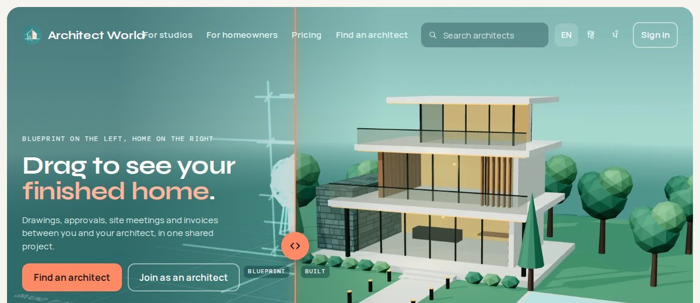
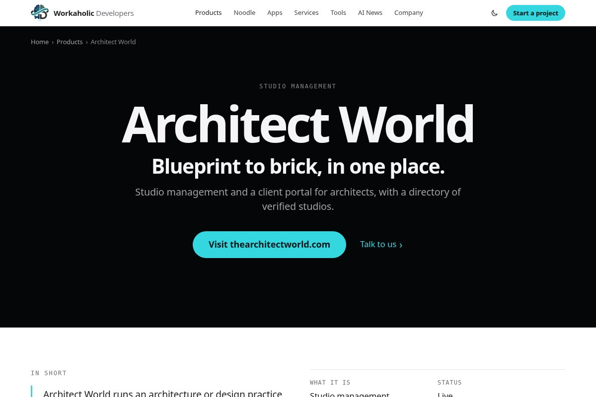

# Architect World

**Studio management and a client portal for architects, with a directory of verified studios.**

> This is a public showcase repository. It describes the product and links to it; the source code is private.

- Product site: https://thearchitectworld.com
- Product page: https://workaholicdevelopers.com/products/architectworld

## What it is

Architect World runs an architecture or design practice in one place — clients, stage plans, drawings, approvals and GST invoices — and gives every client a portal to follow the work, comment, approve and pay. Homeowners can find a verified architect in its directory. The computer version works today; iPhone and Android apps are coming.

## Who it's for

Architects, interior designers, landscape designers and consultants who run projects for clients, and the homeowners and businesses who hire them.

## Features

- **Drawings and markup.** PDFs, images, DWG/DXF and 3D models (GLB, OBJ, FBX), with pins, versions and side-by-side compare.
- **A client portal.** Progress by stage, shared drawings, change requests, approvals with a one-time code and a signed record.
- **GST invoices.** CGST and SGST or IGST by place of supply, credit notes, receipts and reminders; clients pay you directly by UPI or bank.
- **Team and time.** Roles for architects, draftsmen, site engineers and accountants, tasks with checklists, and a timer.
- **Meetings on SeeUAll.** Site visits and video meetings scheduled from the project, with calendar invites and minutes.
- **Verified directory.** Studios show their identity and COA registration before they are listed. English, Hindi and Punjabi.

## Screenshots

*Architect World on workaholicdevelopers.com*

## Who builds it

Built and run by Workaholic Developers.

---

Built by [Workaholic Developers](https://workaholicdevelopers.com), a software company with teams in India and Canada. Questions or a project in mind: info@workaholicdevelopers.com
